<a id="top"></a>

<p align="center">
  
</p>

# Cinema 9D Edição

**Você grava falando. O agente edita. Você aprova.**

Um método para transformar gravações de fala em **vídeos verticais editados**, com cortes, legendas sincronizadas, telas, cards e a identidade da sua marca. Você trabalha com um agente de IA no terminal (**Codex** ou **Claude Code**), e a transcrição, o render e a exportação rodam **no seu computador**.

<p align="center">
  <a href="#passo-a-passo"><strong>COMEÇAR AGORA →</strong></a>
  &nbsp;·&nbsp;
  <a href="#como-funciona">COMO FUNCIONA</a>
  &nbsp;·&nbsp;
  <a href="#comandos">COMANDOS</a>
  &nbsp;·&nbsp;
  <a href="#custos-e-limites">CUSTOS E LIMITES</a>
  &nbsp;·&nbsp;
  <a href="LICENSE">MIT</a>
</p>

<p align="center">
  <code>Codex</code> · <code>Claude Code</code> · <code>Whisper local</code> · <code>Remotion</code> · <code>FFmpeg</code> · <code>versão 0.4.0</code>
</p>

---

## Para quem é

Para quem grava vídeos curtos falando para a câmera, como criadores, professores, profissionais liberais, pequenas marcas, agências e editores. Serve para quem quer um processo **repetível e rastreável**, sem mandar a gravação para um editor online.

- **Você entrega:** a gravação, o logo e as cores, as telas do produto e um briefing curto.
- **O agente faz:** lê a fala palavra por palavra, decide cortes e cenas, monta a edição e mostra uma prévia.
- **Você decide:** pede ajustes e aprova. Sem a sua aprovação, nada é exportado.

> **O que ele não é:** um editor automático de um clique. Os scripts transcrevem, propõem cortes por silêncio, validam e renderizam; a direção criativa é do agente que você está usando, e a aprovação é sua.

<a id="como-funciona"></a>

## Como funciona

<p align="center">
  
</p>

| Quem | O que faz |
|---|---|
| **Você** | Grava, fornece marca e briefing, assiste à prévia, pede ajustes e aprova a revisão atual. |
| **Agente** (Codex ou Claude Code) | Revisa a transcrição e os cortes, escreve `cortes.json` e `cenas.json`, escolhe telas e movimentos, roda os comandos e confere a prévia. |
| **Automático** (scripts locais) | Transcreve com Whisper, extrai quadros, propõe cortes, remapeia legendas, valida e renderiza prévias e finais. |

A aprovação (`aprovar --por "Nome"`) fica ligada ao hash da prévia e dos dados da edição. Se algo mudar depois, o `final` se recusa a exportar até haver nova prévia e nova aprovação. É um controle local de revisão; não autentica a identidade de ninguém.

## Um método, várias produções

<p align="center">
  
</p>

- **Instalação central:** este repositório, clonado uma vez. O executável `bin/cinema-edicao` funciona a partir de qualquer pasta do terminal.
- **Produção:** uma pasta por vídeo, onde você quiser. A gravação original em `entrada/` nunca é alterada.
- **Biblioteca local (opcional):** seus estilos e kits de marca, por padrão em `~/projetos/cinema-9d-biblioteca`, fora do repositório.

<details>
<summary><strong>O que tem dentro de uma produção</strong></summary>

```text
minha-producao/
├── job.json                 configuração do trabalho
├── entrada/                 gravação original (somente leitura)
├── roteiro/briefing.md      objetivo, público e preferências
├── marca/identidade.json    cores, fonte e logo
├── interface/               telas do produto
├── elementos/               imagens e sons autorizados
├── referencias/             vídeos e imagens de referência
├── edicao/                  cortes, cenas e aprovação da revisão
├── trabalho/                transcrição, quadros, plano e cache
├── aprendizados/            observações e propostas locais
└── saida/                   prévias e exportações finais
```

</details>

## Estilos e várias versões

<p align="center">
  
</p>

- **Estilos:** perfis versionados de cores, tipografia, legendas e composição. O catálogo traz o perfil neutro `exemplo` 1.0.0; o da sua marca fica na sua biblioteca. Veja [estilos](docs/ESTILOS.md) e [criar estilo e kit](docs/CRIAR-ESTILO.md).
- **Várias versões:** `produzir "/producao" --versoes 3 --cpu` cria um lote com uma pasta por versão e uma galeria em `saida/lotes/<lote>/index.html`. Veja [orquestração](docs/ORQUESTRACAO.md).
- **Aprendizados:** `aprender` registra observações locais numa produção. Elas não alteram o método nem treinam modelos. Veja [novos projetos](docs/novos-projetos.md).

<a id="passo-a-passo"></a>

## Passo a passo

<p align="center">
  
</p>

O passo a passo abaixo parte de um Mac sem nada instalado. Se você já usa Node, FFmpeg e um agente de IA no terminal, pule para o **passo 2**.

### Passo 1 · Prepare o Mac

1. Instale o [Homebrew](https://brew.sh) se ainda não tiver. O comando está na página inicial do site.
2. Instale as ferramentas:

   ```bash
   brew install node ffmpeg whisper-cpp git
   ```

3. Instale e entre num agente: [Claude Code](https://docs.anthropic.com/en/docs/claude-code) **ou** [Codex](https://github.com/openai/codex). Cada um usa a sua própria conta e assinatura.

> Requisitos: Node.js 20 ou superior, FFmpeg e FFprobe, Whisper.cpp (`whisper-cli`), Git e cerca de **4 GB livres** (dependências, navegador de render e modelo Whisper). Validado no macOS com Apple Silicon. Linux não foi testado e Windows nativo não é suportado.

### Passo 2 · Instale o Cinema 9D Edição (uma vez só)

```bash
mkdir -p ~/projetos
git clone https://github.com/daniel9ds/cinema-9d-edicao.git ~/projetos/cinema-9d-edicao
cd ~/projetos/cinema-9d-edicao
npm ci
npm run setup
npm run instalar:skill
npm run doctor
```

| Comando | O que faz |
|---|---|
| `npm ci` | Instala as dependências com as versões travadas no `package-lock.json`. |
| `npm run setup` | Baixa o modelo Whisper small (cerca de 466 MiB) e confere o SHA-256, prepara o navegador de render do Remotion e cria três efeitos sonoros com FFmpeg. |
| `npm run instalar:skill` | Liga a skill em `~/.claude/skills/` e `~/.codex/skills/`. Feche e abra o agente depois. |
| `npm run doctor` | Mostra o que está pronto e o que falta. |

### Passo 3 · Teste com a demonstração (opcional)

Antes de usar uma gravação sua, veja o método funcionando com vídeo e som sintéticos:

```bash
~/projetos/cinema-9d-edicao/bin/cinema-edicao demo "/tmp/minha-demo"
~/projetos/cinema-9d-edicao/bin/cinema-edicao previa "/tmp/minha-demo"
```

A prévia e os quadros aparecem em `/tmp/minha-demo/saida/previas/`.

### Passo 4 · Crie a pasta do seu vídeo

```bash
~/projetos/cinema-9d-edicao/bin/cinema-edicao iniciar "$HOME/videos/meu-primeiro" --nome "Meu primeiro vídeo" --video "/caminho/da/gravacao.mov"
```

Depois, dentro dessa pasta:

- coloque o **logo** e a **fonte** em `marca/` e ajuste as cores em `marca/identidade.json`;
- coloque **prints do produto** em `interface/`, se houver;
- escreva em `roteiro/briefing.md` o objetivo, o público e o que não pode faltar ([modelo de briefing](docs/briefing-modelo.md)).

### Passo 5 · Peça ao agente

Abra o agente em qualquer pasta e cole o pedido, trocando o caminho:

**Claude Code**

```text
Use a skill cinema-9d-edicao para a produção em ~/videos/meu-primeiro.
Leia o briefing e os materiais, prepare a transcrição e os cortes, crie o plano de cenas conforme a fala
e me mostre o plano e a prévia. Não use serviços pagos e não aprove sem o meu OK.
```

**Codex**

```text
Use $cinema-9d-edicao para a produção em ~/videos/meu-primeiro.
Leia o briefing e os materiais, prepare a transcrição e os cortes, crie o plano de cenas conforme a fala
e me mostre o plano e a prévia. Não use serviços pagos e não aprove sem o meu OK.
```

O agente roda `preparar`, revisa a fala e os cortes, escreve as cenas, gera a prévia em 540×960 e mostra o resultado.

### Passo 6 · Assista, ajuste e aprove

1. Assista à prévia em `saida/previas/`. Peça os ajustes em linguagem normal, por exemplo "corta a repetição do começo" ou "mostra o print do app quando eu falo do cadastro".
2. A cada ajuste o agente gera uma nova prévia.
3. Quando estiver bom, diga que aprova. O agente registra a aprovação com o seu nome e exporta o vídeo final:

   ```bash
   ~/projetos/cinema-9d-edicao/bin/cinema-edicao aprovar "$HOME/videos/meu-primeiro" --por "Seu nome"
   ~/projetos/cinema-9d-edicao/bin/cinema-edicao final "$HOME/videos/meu-primeiro"
   ```

O MP4 final, em 1080×1920, fica em `saida/final/` com um relatório técnico ao lado.

> **Dica:** para o próximo vídeo, repita a partir do **passo 4** com uma pasta nova. A instalação é uma só.

<a id="comandos"></a>

## Comandos

Use o caminho completo do executável (`~/projetos/cinema-9d-edicao/bin/cinema-edicao`) e o caminho da produção. `bin/cinema-edicao help` lista tudo.

| Etapa | Comando | Resultado |
|---|---|---|
| Criar | `iniciar "/producao" --video arquivo` | Pasta da produção com a estrutura pronta (`--estilo` e `--kit` opcionais) |
| Preparar | `preparar "/producao"` | Quadros, transcrição local e propostas de `cortes.json` e `cenas.json` |
| Atualizar o plano | `planejar "/producao"` | Legendas remapeadas e `trabalho/plano-cenas.md` |
| Validar | `validar "/producao"` | Checagem de esquema, caminhos e tempos |
| Prévia | `previa "/producao"` | MP4 540×960 e três quadros (`--quadros` gera só os quadros) |
| Acompanhar | `studio "/producao"` | Remotion Studio local, sincronizado com os dados |
| Nova revisão | `revisao "/producao" --nome r02` | Guarda as decisões atuais antes de mudar uma prévia entregue |
| Aprovar | `aprovar "/producao" --por "Nome"` | Aprovação ligada à prévia atual; só depois do seu OK |
| Exportar | `final "/producao"` | MP4 1080×1920 com relatório técnico em `saida/final/` |
| Estado | `status "/producao"` | Situação da revisão, da prévia e da aprovação |

Para aprovar, `edicao/cenas.json` precisa estar com `status: "reviewed"`. Os tempos de `cortes.json` são da gravação original; os de `cenas.json`, da edição. Formatos e campos em [método e arquivos](docs/metodo.md).

<a id="custos-e-limites"></a>

## Custos, dependências e limites

**Custos.** O método não inclui credenciais, não contrata serviços e não faz chamadas pagas. Whisper, FFmpeg e Remotion rodam na sua máquina. O que pode custar:

- O agente (Codex ou Claude Code) segue o plano ou a cobrança do seu provedor.
- O Remotion tem [licença própria](https://www.remotion.dev/license): empresas podem precisar de licença paga para uso comercial.
- Imagem, vídeo, música ou voz gerados por IA são **opcionais** e só entram com o seu pedido. Para os servidores MCP do Google (Veo, Nano Banana, Lyria, Chirp3), veja [geração com o Google](docs/GERACAO-GOOGLE.md): cada geração é paga, aprovada uma a uma, baixada e registrada na produção.

**Dependências.** Versões npm fixadas em `package-lock.json` (Remotion 4.0.535, React 19, Zod 4, TypeScript 5.9). O setup baixa o modelo Whisper e um navegador headless compatível com o Remotion.

**Limites desta versão:**

- A transcrição pode errar nomes, números e termos; a revisão é do agente e sua.
- Os cortes automáticos detectam silêncio. Repetições, erros de fala e ritmo dependem da revisão.
- Enquadramento por foco fixo configurável por cena. Não há rastreamento facial, remoção de fundo, máscara automática nem 3D.
- A checagem técnica confere estrutura, duração, áudio e resolução, não a qualidade criativa.
- Render sequencial e local, sem fila remota nem publicação automática.
- Validado apenas no macOS (Apple Silicon).

Evidências técnicas: [validação 0.4.0](docs/VALIDACAO-0.4.0.md). Para atualizar: `git pull --ff-only` e `npm ci`, depois leia [atualização](docs/ATUALIZACAO.md).

## Documentação

| Documento | Conteúdo |
|---|---|
| [docs/INSTALACAO.md](docs/INSTALACAO.md) | Requisitos, setup, skill e evidências |
| [docs/metodo.md](docs/metodo.md) | Operação, `job.json`, identidade, cortes e cenas |
| [docs/novos-projetos.md](docs/novos-projetos.md) | Novos temas, montagens próprias e aprendizados |
| [docs/ORQUESTRACAO.md](docs/ORQUESTRACAO.md) | Lotes com N versões, retomada, galeria e aprovação |
| [docs/ESTILOS.md](docs/ESTILOS.md) | Perfis de estilo e snapshots |
| [docs/CRIAR-ESTILO.md](docs/CRIAR-ESTILO.md) | Criar estilo e kit próprios |
| [docs/GERACAO-GOOGLE.md](docs/GERACAO-GOOGLE.md) | Mídia gerada com os servidores MCP `genmedia-*`: aprovação, pastas, manifesto e Remotion |
| [docs/ATUALIZACAO.md](docs/ATUALIZACAO.md) | Atualizar a instalação com segurança |
| [docs/aprendizados-incorporados.md](docs/aprendizados-incorporados.md) | O que cada versão incorporou e seus limites |
| [skills/cinema-9d-edicao/SKILL.md](skills/cinema-9d-edicao/SKILL.md) | Instruções que o agente segue |

## Contribuir e relatar problemas

- **Problemas e sugestões:** abra uma [issue](https://github.com/daniel9ds/cinema-9d-edicao/issues) com o sistema, a saída de `npm run doctor`, o comando e o erro. **Não anexe** gravações, logos, telas ou dados de clientes; reproduza com a `demo`.
- **Contribuições:** leia [CONTRIBUTING.md](CONTRIBUTING.md) e rode `npm run check` e `npm test` antes do pull request.
- **Segurança:** veja [SECURITY.md](SECURITY.md). Não publique segredos nem detalhes de vulnerabilidade numa issue aberta.

## Licença e créditos

Código e documentação originais sob a [licença MIT](LICENSE), © 2026 Daniel da Costa Gomes Martins / 9D Studio.

A licença não substitui as condições do Remotion nem de outros componentes de terceiros, e não concede direitos sobre as marcas 9D e Cinema 9D nem sobre materiais de clientes. Detalhes em [THIRD_PARTY_NOTICES.md](THIRD_PARTY_NOTICES.md).

As ilustrações de fundo do README foram geradas por IA e são apenas ilustrativas: não mostram telas reais do método. Os textos e diagramas por cima são vetores escritos em [`docs/assets/readme/gerar.mjs`](docs/assets/readme/gerar.mjs).

Base conceitual: [Bolo de Camadas](https://github.com/pcauhi/bolo-de-camadas), de Cauhi (MIT), preservado em `vendor/skills/bolo-de-camadas`. O método amplia a proposta de cinco camadas com proposta de cortes, mapeamento de tempos, revisão e aprovação.

<p align="right"><a href="#top">voltar ao topo ↑</a></p>
